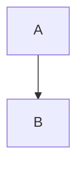

# 다이어그램(Mermaid) 처리

관련 결정: [ADR-0004](../adr/0004-mermaid-prerender-to-image.md)

## 방식
Mermaid 코드펜스를 **이미지로 사전 렌더링**한 뒤 일반 그림으로 삽입한다. HWP에는 Mermaid 개념이 없으므로 벡터 도형으로 변환하지 않는다.

```text
mermaid 코드펜스 → diagram(IR) → 렌더러 → PNG(또는 SVG) → asset → insertPictureEx
```

## 환경별 렌더러

| 환경 | 렌더러 | 비고 |
|---|---|---|
| CLI | `@mermaid-js/mermaid-cli` (Puppeteer/Chromium) | Chromium 필요. CI 이미지에 포함 |
| 웹 | 브라우저에서 `mermaid` 라이브러리로 SVG 렌더 → Canvas로 PNG 변환 | 서버 불필요 |
| 사전 렌더 | 이미 만든 이미지를 ``로 참조 | 렌더러가 없을 때 대안 |

## 출력 형식
- **PNG 권장**: rhwp의 그림 삽입은 확장자 인자를 받는다. SVG 삽입 지원 여부는 스파이크(S-04)로 확인한다.
- 해상도: 가로 폭 기준 2배(retina) 렌더 후 본문 폭에 맞춰 축소 삽입.
- 배경은 흰색으로 고정(인쇄 안정성).

## 옵션 (코드펜스 속성)
````

````

| 속성 | 의미 | 기본 |
|---|---|---|
| `width` | 본문 폭 대비 비율 | 100% 이내 자동 |
| `caption` | 캡션 문구 | 없음 |
| `theme` | mermaid 테마 | `default` |

## 오류 처리
- 문법 오류: 해당 블록을 코드블록 원문으로 대체하고 경고 + 라인 번호 보고. `--strict`는 중단.
- 렌더러 없음: 원문 코드블록으로 대체하고 경고.

## 확장
`plantuml`, `graphviz`(dot) 등은 `kind` 필드와 렌더러 레지스트리로 추가한다(`Env.renderDiagram`).
