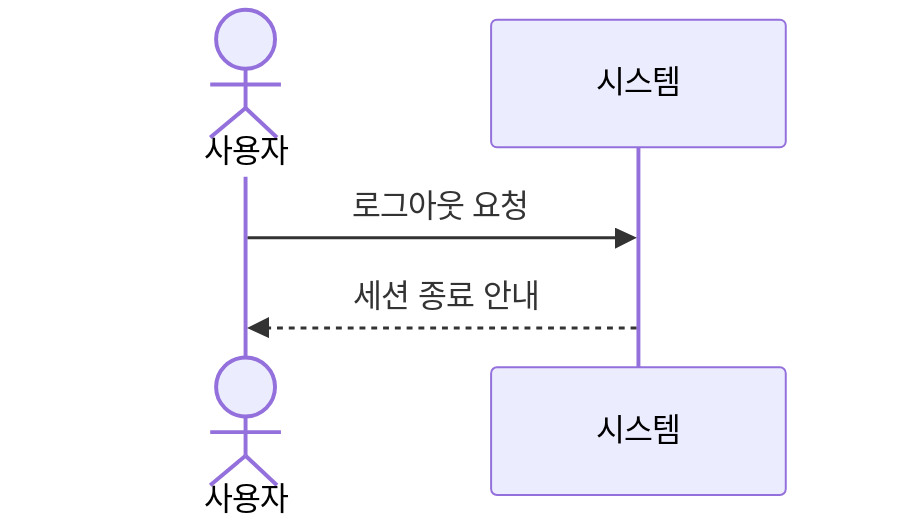

## UC-001 로그인

| 항목 | 내용 |
|---|---|
| 액터 | 일반 회원 |
| 사전조건 | 회원가입이 완료되어 있다 |
| 사후조건 | 세션이 생성된다 |

### 기본 흐름

1. 사용자가 ID와 비밀번호를 입력한다.
2. 시스템이 인증 정보를 확인한다.
3. 시스템이 메인 화면을 표시한다.

### 대안 흐름

1. 인증에 실패하면 오류 메시지를 표시한다.

## UC-002 로그아웃

| 항목 | 내용 |
|---|---|
| 액터 | 일반 회원 |
| 사전조건 | 로그인 상태이다 |
| 사후조건 | 세션이 종료된다 |

### 기본 흐름

1. 사용자가 로그아웃을 선택한다.
2. 시스템이 세션을 종료한다.

## UC-003 비밀번호 변경

| 항목 | 내용 |
|---|---|
| 액터 | 일반 회원 |
| 사전조건 | 로그인 상태이다 |
| 사후조건 | 비밀번호가 변경된다 |

### 기본 흐름

1. 사용자가 현재 비밀번호와 새 비밀번호를 입력한다.
2. 시스템이 현재 비밀번호를 확인한다.
3. 시스템이 새 비밀번호를 저장한다.

### 대안 흐름

1. 현재 비밀번호가 틀리면 오류를 표시한다.
2. 새 비밀번호가 규칙에 맞지 않으면 안내 문구를 표시한다.
