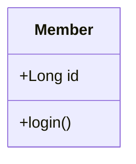

## Member

| 항목 | 내용 |
|---|---|
| 패키지 | com.example.member |
| 설명 | 회원 정보를 나타낸다 |

### 속성

| 이름 | 타입 | 가시성 | 설명 |
|---|---|---|---|
| id | Long | private | 회원 식별자 |
| name | String | private | 이름 |
| email | String | private | 이메일 |

### login

| 항목 | 내용 |
|---|---|
| 설명 | 인증을 수행한다 |

#### 파라미터

| 이름 | 타입 | 설명 |
|---|---|---|
| email | String | 이메일 |
| password | String | 비밀번호 |

### logout

| 항목 | 내용 |
|---|---|
| 설명 | 세션을 종료한다 |

## Session

| 항목 | 내용 |
|---|---|
| 패키지 | com.example.auth |
| 설명 | 로그인 세션 |

### 속성

| 이름 | 타입 | 가시성 | 설명 |
|---|---|---|---|
| token | String | private | 세션 토큰 |
